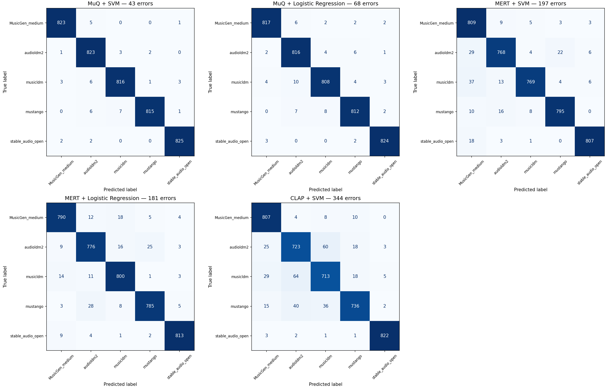

# AI vs Original Music Classification


Semester project for the Artificial Intelligence course at the Ukrainian Catholic University (2026).

This project addresses the question: which generator produced a given music clip. Our hypothesis is that each text-to-music model leaves characteristic traces in its output, and that a classifier can learn to recognise them.

On the FakeMusicCaps dataset, the hypothesis is supported. The best model, an SVM trained on MuQ embeddings, achieves a Macro F1 of 0.99 on the test set.

## Data

We use [FakeMusicCaps](https://zenodo.org/records/15063698). The dataset contains 27,605 ten-second clips: each of 5,521 text prompts from [MusicCaps](https://huggingface.co/datasets/google/MusicCaps) was rendered by five generators (MusicGen, AudioLDM2, MusicLDM, Mustango and Stable Audio Open).

During exploratory analysis we found that clip duration differs slightly between generators. To prevent the models from relying on this trivial cue, all clips are trimmed or padded to exactly 10 seconds.

The data is split 70/15/15 into training, validation and test sets at the prompt level. All five versions of a prompt belong to the same split, so the model is never evaluated on a prompt it has seen during training. The audio is not stored in the repository because of its size; it can be downloaded with `scripts/download_data.py`.

## Method

We compare four audio representations:

- 36 handcrafted acoustic features (energy, spectral characteristics and MFCCs), computed with librosa;
- embeddings from three pretrained audio models, used without fine-tuning: [CLAP](https://huggingface.co/laion/clap-htsat-unfused), [MERT](https://huggingface.co/m-a-p/MERT-v1-95M) and [MuQ](https://github.com/tencent-ailab/MuQ).

For each representation we train Logistic Regression, SVM and k-NN classifiers. The five best combinations are selected by validation Macro F1, and only these are evaluated on the test set.

## Results

| Representation + classifier | Validation F1 | Test F1 |
|---|---:|---:|
| MuQ + SVM | 0.986 | 0.990 |
| MuQ + Logistic Regression | 0.980 | 0.984 |
| MERT + Logistic Regression | 0.963 | 0.956 |
| MERT + SVM | 0.968 | 0.953 |
| CLAP + SVM | 0.923 | 0.917 |
| Handcrafted + SVM | 0.859 | – |
| Majority-class baseline | 0.067 | – |

The choice of representation has a much larger effect than the choice of classifier. MuQ and MERT, both trained specifically on music, outperform CLAP, which was trained to align audio with text. This suggests that the traces left by generators relate more to the acoustic structure of the signal than to its musical content.

The best model misclassifies 43 of 4,145 test clips, compared with 344 for CLAP. Most of CLAP's errors are confusions between AudioLDM2 and MusicLDM, possibly because the two models share a similar architecture.

Detailed tables and figures are available in `results/`.



## Reproducing the results

```bash
pip install -r requirements.txt
pip install -e .
pip install soundfile torch transformers tqdm umap-learn seaborn muq easydict

python scripts/download_data.py
```

After downloading, extract the archive into `data/raw/fakemusiccaps/`. Then run the following steps in order:

1. `notebooks/01-data-exploration.ipynb`
2. `python scripts/prepare_dataset.py --mode both`
3. `notebooks/02-handcrafted-features-and-embeddings.ipynb` (embedding extraction is recommended on a GPU)
4. `notebooks/03-baseline-model.ipynb`
5. `notebooks/04-error-analysis.ipynb`

For a quick check, set `DATASET_MODE = "pilot"` in the notebooks. This runs the pipeline on a subset of 3,000 clips.

## Limitations and future work

All current results are obtained on the same five generators the models were trained on, within a single dataset. The key open question is how the system behaves on audio from a generator it has not seen before. We plan to study this next using [SunoCaps](https://www.kaggle.com/datasets/miguelcivit/sunocaps) and [AIME](https://huggingface.co/datasets/disco-eth/AIME). We also plan to test whether the results hold after loudness normalisation, since loudness varies between generators and may contribute to the classification.

## Team

| Member | Responsibilities | Contribution |
|---|---|---:|
| Alina Bodnar ([@alinabodnarpn](https://github.com/alinabodnarpn)) | Handcrafted acoustic feature extraction, exploratory data analysis (EDA), feature group comparison, and feature importance analysis | TBD % |
| Sofia Vitchynkina ([@vitchynkinas](https://github.com/vitchynkinas)) | Baseline classification and evaluation using Logistic Regression, SVM, and k-NN across four audio representations and performance evaluation| TBD % |
| Olena Dovbenchuk ([@Olenadovb](https://github.com/Olenadovb)) | Dataset preparation, group-aware data splitting, CLAP, MERT and MuQ embeddings, PCA/UMAP visualization, and cross-model error analysis.
 | TBD % |

Mentor: Olesia Omelchuk

## AI usage

## License
The code in this repository is released under the MIT license (see `LICENSE`). The MIT license does not cover the data, which remains under the terms of its original sources:

| Dataset | License | How it is used in project |
|---|---|---|
| [FakeMusicCaps](https://zenodo.org/records/15063698) (v2) | [CC BY-NC 4.0](https://creativecommons.org/licenses/by-nc/4.0/) | Audio clips for training and evaluation. Not redistributed; downloaded by `scripts/download_data.py`. |
| [MusicCaps](https://huggingface.co/datasets/google/MusicCaps) | [CC BY-SA 4.0](https://creativecommons.org/licenses/by-sa/4.0/) | Text captions (`musiccaps-public.csv`) for metadata and error analysis. |

Because FakeMusicCaps is licensed for non-commercial use only, the models and results in this project may only be used for research and educational purposes.# AI vs Original Music Classification


Semester project for the Artificial Intelligence course at the Ukrainian Catholic University (2026).

This project addresses the question: which generator produced a given music clip. Our hypothesis is that each text-to-music model leaves characteristic traces in its output, and that a classifier can learn to recognise them.

On the FakeMusicCaps dataset, the hypothesis is supported. The best model, an SVM trained on MuQ embeddings, achieves a Macro F1 of 0.99 on the test set.

## Data

We use [FakeMusicCaps](https://zenodo.org/records/15063698). The dataset contains 27,605 ten-second clips: each of 5,521 text prompts from [MusicCaps](https://huggingface.co/datasets/google/MusicCaps) was rendered by five generators (MusicGen, AudioLDM2, MusicLDM, Mustango and Stable Audio Open).

During exploratory analysis we found that clip duration differs slightly between generators. To prevent the models from relying on this trivial cue, all clips are trimmed or padded to exactly 10 seconds.

The data is split 70/15/15 into training, validation and test sets at the prompt level. All five versions of a prompt belong to the same split, so the model is never evaluated on a prompt it has seen during training. The audio is not stored in the repository because of its size; it can be downloaded with `scripts/download_data.py`.

## Method

We compare four audio representations:

- 36 handcrafted acoustic features (energy, spectral characteristics and MFCCs), computed with librosa;
- embeddings from three pretrained audio models, used without fine-tuning: [CLAP](https://huggingface.co/laion/clap-htsat-unfused), [MERT](https://huggingface.co/m-a-p/MERT-v1-95M) and [MuQ](https://github.com/tencent-ailab/MuQ).

For each representation we train Logistic Regression, SVM and k-NN classifiers. The five best combinations are selected by validation Macro F1, and only these are evaluated on the test set.

## Results

| Representation + classifier | Validation F1 | Test F1 |
|---|---:|---:|
| MuQ + SVM | 0.986 | 0.990 |
| MuQ + Logistic Regression | 0.980 | 0.984 |
| MERT + Logistic Regression | 0.963 | 0.956 |
| MERT + SVM | 0.968 | 0.953 |
| CLAP + SVM | 0.923 | 0.917 |
| Handcrafted + SVM | 0.859 | – |
| Majority-class baseline | 0.067 | – |

The choice of representation has a much larger effect than the choice of classifier. MuQ and MERT, both trained specifically on music, outperform CLAP, which was trained to align audio with text. This suggests that the traces left by generators relate more to the acoustic structure of the signal than to its musical content.

The best model misclassifies 43 of 4,145 test clips, compared with 344 for CLAP. Most of CLAP's errors are confusions between AudioLDM2 and MusicLDM, possibly because the two models share a similar architecture.

Detailed tables and figures are available in `results/`.


## Reproducing the results

```bash
pip install -r requirements.txt
pip install -e .
pip install soundfile torch transformers tqdm umap-learn seaborn muq easydict

python scripts/download_data.py
```

After downloading, extract the archive into `data/raw/fakemusiccaps/`. Then run the following steps in order:

1. `notebooks/01-data-exploration.ipynb`
2. `python scripts/prepare_dataset.py --mode both`
3. `notebooks/02-handcrafted-features-and-embeddings.ipynb` (embedding extraction is recommended on a GPU)
4. `notebooks/03-baseline-model.ipynb`
5. `notebooks/04-error-analysis.ipynb`

For a quick check, set `DATASET_MODE = "pilot"` in the notebooks. This runs the pipeline on a subset of 3,000 clips.

## Limitations and future work

All current results are obtained on the same five generators the models were trained on, within a single dataset. The key open question is how the system behaves on audio from a generator it has not seen before. We plan to study this next using [SunoCaps](https://www.kaggle.com/datasets/miguelcivit/sunocaps) and [AIME](https://huggingface.co/datasets/disco-eth/AIME). We also plan to test whether the results hold after loudness normalisation, since loudness varies between generators and may contribute to the classification.

## Team

| Member | Responsibilities |
|---|---|
| Alina Bodnar ([@alinabodnarpn](https://github.com/alinabodnarpn)) | Handcrafted acoustic feature extraction, exploratory data analysis (EDA), feature group comparison, and feature importance analysis |
| Sofia Vitchynkina ([@vitchynkinas](https://github.com/vitchynkinas)) | Baseline classification and evaluation using Logistic Regression, SVM, and k-NN across four audio representations and performance evaluation|
| Olena Dovbenchuk ([@Olenadovb](https://github.com/Olenadovb)) | Dataset preparation, group-aware data splitting, CLAP, MERT and MuQ embeddings, PCA/UMAP visualization, and cross-model error analysis.
 |

Mentor: Olesia Omelchuk

## AI usage
| Tool | Used for | How the result was checked |
|---|---|---|
| ChatGPT | Project planning and first drafts of README sections | Reviewed and edited by the team; plan compared against the course requirements |
| Claude | First drafts of `README.md` and `data/README.md`, written from the repository's code, notebooks and result files | Every number checked against `results/*.csv` and notebook outputs; dataset licenses checked on the Zenodo and Hugging Face pages; text edited by the team |

## License
The code in this repository is released under the MIT license (see `LICENSE`). The MIT license does not cover the data, which remains under the terms of its original sources:

| Dataset | License | How it is used in project |
|---|---|---|
| [FakeMusicCaps](https://zenodo.org/records/15063698) (v2) | [CC BY-NC 4.0](https://creativecommons.org/licenses/by-nc/4.0/) | Audio clips for training and evaluation. Not redistributed; downloaded by `scripts/download_data.py`. |
| [MusicCaps](https://huggingface.co/datasets/google/MusicCaps) | [CC BY-SA 4.0](https://creativecommons.org/licenses/by-sa/4.0/) | Text captions (`musiccaps-public.csv`) for metadata and error analysis. |

Because FakeMusicCaps is licensed for non-commercial use only, the models and results in this project may only be used for research and educational purposes. \

If you use the data, please cite the original authors:

> Comanducci, L., Bestagini, P., & Tubaro, S. (2024). *FakeMusicCaps: a Dataset for Detection and Attribution of Synthetic Music Generated via Text-to-Music Models.* arXiv:2409.10684.
>
> Agostinelli, A., et al. (2023). *MusicLM: Generating Music From Text.* arXiv:2301.11325.

The repository is based on the course template [`ucu-ai-course/project-template`](https://github.com/ucu-ai-course/project-template).
